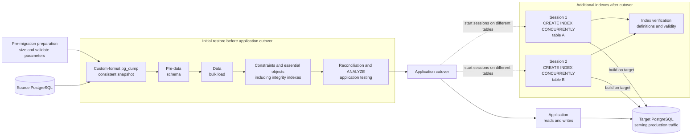

# PostgreSQL Staged Logical Migration with Deferred Index Creation

Restore schema, data, and integrity constraints first, bring the target database online, and build eligible additional indexes afterward using `CREATE INDEX CONCURRENTLY`.

[Leia em português](README.pt-BR.md)

## Overview

This generic PostgreSQL migration procedure separates the work required for application cutover from index creation that can be deferred. It applies to different applications and infrastructures, including self-managed installations and managed services with the required features and privileges.

**Recommended use:** large PostgreSQL databases, especially those with large tables or many expensive indexes, where index creation accounts for a substantial part of the maintenance window. Suitability depends on data volume, index build time, available resources, and application requirements; there is no universal minimum size.

**Technical baseline:** PostgreSQL 16. Check version compatibility, extensions, permissions, and service limits. Database names, hosts, users, tables, and indexes below are examples.

**Terminology:** “staged logical migration with deferred index creation” is a descriptive name, rather than an officially named PostgreSQL migration mode. The implementation uses selective restoration of `pre-data`, `data`, and `post-data`. [pg_restore documentation](https://www.postgresql.org/docs/16/app-pgrestore.html)

## Architecture and sequence



**Sequence:** prepare and validate parameters → restore schema and data → complete integrity and essential objects → validate → switch the application to the target → build eligible additional indexes concurrently → verify remaining objects.

Application traffic and index-building sessions use the same target database. Builds on different tables can run simultaneously within available capacity. Source writes must be stopped for the final dump or handled through a separately coordinated synchronization process.

## Benefits and tradeoffs

The main benefit is a **shorter application downtime window**: eligible additional indexes no longer have to finish before the target starts serving traffic.

- **Earlier application recovery:** defer indexes that are not required for integrity or acceptable application performance.
- **Integrity before cutover:** complete primary keys, unique constraints, foreign keys, exclusion constraints, and required supporting indexes before accepting new writes. [Constraints](https://www.postgresql.org/docs/16/ddl-constraints.html)
- **Continued writes during index creation:** `CREATE INDEX CONCURRENTLY` avoids the write-blocking lock held by a conventional build. [CREATE INDEX](https://www.postgresql.org/docs/16/sql-createindex.html)
- **Resource control:** tune simultaneous builds, maintenance memory, and internal workers to match available capacity. [Resource configuration](https://www.postgresql.org/docs/16/runtime-config-resource.html)
- **Clearer troubleshooting and recovery:** separate logs and object inventories help locate failures and prepare targeted recovery after checking what already succeeded.

Loading data before creating deferrable indexes avoids maintaining those indexes for every inserted row. A complete `pg_restore` already loads data before post-data objects; this approach additionally prioritizes essential objects and moves eligible indexes beyond application cutover. [Bulk loading](https://www.postgresql.org/docs/16/populate.html)

**The primary gain is availability, not necessarily shorter total migration time.** Concurrent builds require additional work and compete with application traffic for resources. Performance-critical indexes must be ready before cutover. Measure each phase and actual downtime rather than assuming a fixed percentage improvement.

### What constraints before indexes means

Primary key and unique constraints normally create their own indexes. Exclusion constraints also depend on indexes. These belong to the integrity phase. Standalone unique indexes and other indexes required by dependencies or application behavior must also be ready before cutover. Only eligible additional indexes are deferred. [Constraints](https://www.postgresql.org/docs/16/ddl-constraints.html)

## 0. Size and configure the target before migration

Complete parameter sizing, rehearsal, and server-level changes **before the migration starts**, including any required reload or restart. Reserve resources for the application that will share the target with index builds after cutover.

| Setting or control | Prepare before migration | Apply or verify during execution |
| --- | --- | --- |
| `max_worker_processes` | Size the process pool; changes require a server restart. | Confirm the effective value before starting. |
| `max_parallel_workers` | Size the parallel worker pool within the available process capacity. | Check capacity shared with other workloads. |
| `maintenance_work_mem` | Select and test a per-operation memory budget. | Apply the planned value to each restore or index session that needs it. |
| `max_parallel_maintenance_workers` | Select and test the per-build worker limit. | Apply it in each index-building session. |
| Restore jobs and simultaneous index sessions | Rehearse concurrency for data loading and for builds alongside application traffic. | Use the planned limits and reduce concurrency if application service degrades. |

Inspect current values on the target:

```sql
SELECT name, setting, unit, context, pending_restart
FROM pg_settings
WHERE name IN (
  'maintenance_work_mem',
  'max_parallel_maintenance_workers',
  'max_parallel_workers',
  'max_worker_processes'
)
ORDER BY name;
```

### Apply the planned increases before starting

The following profile is an **example for a target with sufficient CPU and RAM**, not a universal recommendation for large databases. Compare it with existing values: do not replace a higher, deliberately configured value with a smaller example. Account for extensions and other background workers as well as application traffic.

| Parameter | Illustrative value | Scope used below |
| --- | --- | --- |
| `max_worker_processes` | `16` | Server; restart required |
| `max_parallel_workers` | `8` | Server; reload |
| `maintenance_work_mem` | `1GB` | Dedicated migration login in the target database |
| `max_parallel_maintenance_workers` | `2` | Dedicated migration login in the target database |

#### Configure the server worker pools

On a self-managed target, connect with sufficient administrative privileges and run each command outside a transaction block:

```sql
ALTER SYSTEM SET max_worker_processes = 16;
ALTER SYSTEM SET max_parallel_workers = 8;

SELECT pg_reload_conf();
```

`ALTER SYSTEM` writes server-wide settings to `postgresql.auto.conf`. A reload applies reloadable settings; changing `max_worker_processes` requires a server restart. [ALTER SYSTEM](https://www.postgresql.org/docs/16/sql-altersystem.html)

If `max_worker_processes` changed, restart the target **before migration**, using its normal service manager. For a self-managed installation administered with `pg_ctl`, the equivalent command is:

```bash
# Run as the PostgreSQL operating-system owner; replace the data directory.
pg_ctl -D "/path/to/PGDATA" restart -m fast
```

Use this only for an instance managed with `pg_ctl`; installations managed by systemd, Windows Services, containers, or an operator should use their corresponding management mechanism. Restarting disconnects current sessions.

For managed PostgreSQL services, apply the same planned values through the provider's parameter configuration and restart mechanism when required. Do not assume `ALTER SYSTEM` or operating-system access is available.

#### Configure dedicated restore and index logins

To establish the maintenance settings **before migration** without raising the memory default for every application session, configure defaults for the dedicated logins in the target database. Replace `RESTORE_USER`, `INDEX_USER`, and `example_db` with existing objects. Capture their previous role/database settings before changing them.

```sql
SELECT COALESCE(r.rolname, 'ALL') AS role_name,
       COALESCE(d.datname, 'ALL') AS database_name,
       s.setconfig
FROM pg_db_role_setting s
LEFT JOIN pg_roles r ON r.oid = s.setrole
LEFT JOIN pg_database d ON d.oid = s.setdatabase
ORDER BY 1, 2;
```

Run with the privileges required to change these role defaults:

```sql
ALTER ROLE RESTORE_USER IN DATABASE example_db
  SET maintenance_work_mem = '1GB';
ALTER ROLE RESTORE_USER IN DATABASE example_db
  SET max_parallel_maintenance_workers = 2;

ALTER ROLE INDEX_USER IN DATABASE example_db
  SET maintenance_work_mem = '1GB';
ALTER ROLE INDEX_USER IN DATABASE example_db
  SET max_parallel_maintenance_workers = 2;
```

If one dedicated login performs both tasks, configure it once. These defaults apply to **new connections** logging in directly as that role to the target database; `SET ROLE` does not load them. Reconnect before validating or starting the restore. [ALTER ROLE](https://www.postgresql.org/docs/16/sql-alterrole.html)

Keep these logins separate from the application login. Memory is budgeted per maintenance operation: multiple simultaneous builds can each use their own allocation. The session `SET` examples in step 5 can reapply the same prepared values or override them explicitly.

#### Verify the effective configuration

After any required restart, open a new connection using each dedicated login and run:

```sql
SHOW max_worker_processes;
SHOW max_parallel_workers;
SHOW maintenance_work_mem;
SHOW max_parallel_maintenance_workers;

SELECT name, setting, unit, source, pending_restart
FROM pg_settings
WHERE name IN (
  'max_worker_processes',
  'max_parallel_workers',
  'maintenance_work_mem',
  'max_parallel_maintenance_workers'
)
ORDER BY name;
```

Confirm the intended effective values and no unresolved restart requirement for these settings before starting the migration. Rehearse the restore job count and simultaneous index builds with this configuration. After completion, restore temporary settings to the recorded baseline; do not use `RESET` blindly if custom values existed beforehand.

Use the server configuration or managed-service configuration mechanism for server-level changes. Capture original values and check `pending_restart` after changes. Do not plan a restart-dependent change for the middle of the migration. [Resource configuration](https://www.postgresql.org/docs/16/runtime-config-resource.html)

**Session settings must be effective in every working connection.** The `ALTER ROLE ... IN DATABASE` defaults above initialize new connections automatically. Alternatively, apply the prepared settings explicitly in each session. A `SET` issued in an unrelated preparation connection does not configure later `pg_restore` or `psql` connections. Prepare the session scripts before the migration and execute their settings at the start of each relevant session, before its work begins. Connection startup options, such as `PGOPTIONS`, are another option where supported. [Connection environment variables](https://www.postgresql.org/docs/16/libpq-envars.html)

The values shown in step 5 are an illustrative profile to validate during this preparation, not a recommendation to discover or change the configuration after cutover.

## 1. Prepare the migration and backup

### Prerequisites

- Prepare a new or deliberately empty target database. Check versions, extensions, roles, ownership, tablespaces, privileges, and space for data, indexes, temporary files, and WAL.
- Stop source application writes before the final dump and keep them stopped until cutover. If using CDC, coordinate the snapshot and complete final synchronization before switching traffic.
- Identify critical transactions and indexes that must be available at cutover, including support for foreign key checks under significant update or delete activity.
- Record the expected object inventory, validation owners, and rollback criteria.

`pg_dump` takes a consistent snapshot but does not automatically include later changes. This procedure alone does not provide a lossless migration while source writes continue. Global objects such as roles require separate handling. [pg_dump](https://www.postgresql.org/docs/16/app-pgdump.html)

### Create one custom-format archive

Shell examples use Bash with PostgreSQL clients in `PATH`. Replace uppercase placeholders, database names, paths, tables, and indexes. Configure authentication using `pgpass` or your approved mechanism; keep passwords out of commands.

On Windows, use a compatible Bash environment or adapt the commands to PowerShell. Windows PowerShell 5.1 can write redirected text as UTF-16; explicitly use a compatible encoding such as UTF-8 for `.list` files and verify that `pg_restore` reads them correctly.

```bash
pg_dump -h SOURCE_HOST -p 5432 -U BACKUP_USER -d example_db -Fc -v -f example_db.backup 2> 00_backup.log
```

Use the same archive for every phase. Separate dumps of individual sections can represent different snapshots. Confirm successful completion, archive size, and transfer to the restore host.

```bash
pg_restore --list example_db.backup > full_toc.list
```

Custom and directory archives support selective and parallel restoration. Directory format additionally supports parallel dumps; this guide uses custom format. [pg_dump](https://www.postgresql.org/docs/16/app-pgdump.html)

## 2. Restore schema and data

### Pre-data

```bash
pg_restore -h TARGET_HOST -p 5432 -U RESTORE_USER -d example_db --section=pre-data --exit-on-error --verbose example_db.backup 2> 01_pre_data.log
```

Verify schemas, tables, types, and other objects in this section. Some constraints, including NOT NULL and certain CHECK constraints, can be part of pre-data; not every constraint is created after loading rows. [pg_restore](https://www.postgresql.org/docs/16/app-pgrestore.html)

### Data

```bash
pg_restore -h TARGET_HOST -p 5432 -U RESTORE_USER -d example_db --section=data --jobs=4 --exit-on-error --verbose example_db.backup 2> 02_data.log
```

`--jobs=4` is an example for testing. It controls concurrent restore connections, not workers inside a single index build. [pg_restore](https://www.postgresql.org/docs/16/app-pgrestore.html)

Before proceeding:

- Check a zero exit code and resolve errors in both logs. Check `$?` immediately in Bash or `$LASTEXITCODE` in PowerShell.
- Reconcile critical row counts or business control totals against the final source snapshot. Check sequences, identity values, large objects, and extension data where applicable.
- Keep application writes disabled on the target until integrity and operational validation are complete.

`--exit-on-error` stops execution but does not undo previously committed objects or data. Identify what succeeded and prepare targeted recovery, or restart against a controlled empty target. Do not blindly repeat a partially completed data load.

## 3. Separate and complete integrity objects

### Prepare a reviewed post-data selection

```bash
pg_restore --section=post-data --list example_db.backup > full_post_data.list
```

Copy the list to `integrity_and_essential.list`. Retain entries needed before cutover and comment out deferred entries with a semicolon at the start of the line. Preserve object IDs and dependency order. [pg_restore](https://www.postgresql.org/docs/16/app-pgrestore.html)

- Retain required constraints and validations, including standalone indexes they depend on.
- Retain essential performance indexes, triggers, rules, and other application requirements. Check owners, grants, and row security policies against the complete inventory.
- Track deferred indexes and related metadata, including comments and partition index attachments, through completion.

**Do not select entries solely by matching `CONSTRAINT`.** This can omit dependencies and essential objects. Referenced keys must exist before foreign keys. Rehearse the selection with the intended archive and PostgreSQL version.

### Apply the selection

```bash
pg_restore -h TARGET_HOST -p 5432 -U RESTORE_USER -d example_db --section=post-data --use-list=integrity_and_essential.list --exit-on-error --verbose example_db.backup 2> 03_integrity.log
```

This example runs sequentially to simplify dependency verification. Rehearse concurrency changes. Do not later run the entire post-data section: it would recreate completed objects and build indexes without `CONCURRENTLY`.

### Check constraint validation

```sql
SELECT conrelid::regclass AS table_name, conname, contype
FROM pg_constraint
WHERE connamespace NOT IN
  ('pg_catalog'::regnamespace, 'information_schema'::regnamespace)
  AND NOT convalidated
ORDER BY 1, 2;
```

Investigate results and compare the complete constraint inventory with the source. This query finds unvalidated constraints but does not detect missing ones. Do not introduce `NOT VALID` simply to bring cutover forward.

## 4. Validate and bring the target online

Before switching traffic:

- Confirm data reconciliation, validated required constraints, valid essential indexes, and no unresolved restore errors.
- Verify triggers, functions, rules, RLS policies, roles, owners, grants, sequences, and application connections.
- Refresh statistics and test critical read, insert, update, and delete operations using the application's actual database identity.
- Complete final synchronization if applicable, prevent unintended writes to both databases, and switch application traffic to the target.

```sql
ANALYZE;
```

Run `ANALYZE` with privileges and scope covering the restored tables. Refresh relevant statistics again after creating expression indexes or after significant data changes. [Bulk loading](https://www.postgresql.org/docs/16/populate.html)

Defer an index only after assessing real application behavior without it. Secondary indexes can be essential for response time or relationship checks. Build those before cutover.

Record cutover time, test results, reconciliation evidence, and the deferred index inventory. Downtime ends at successful application cutover; migration work ends after all remaining objects are verified.

### Prepare deferred index scripts

Create `deferred_indexes.list` from the reviewed inventory, then extract SQL:

```bash
pg_restore --section=post-data --use-list=deferred_indexes.list --file=04_extracted_indexes.sql example_db.backup
```

**Do not execute this file unchanged after cutover.** `pg_restore` has no switch to turn index creation into concurrent builds.

Review eligible statements and prepare session-specific scripts using `CREATE INDEX CONCURRENTLY`. Preserve access methods, columns, expressions, predicates, INCLUDE columns, tablespaces, and storage options. Avoid indiscriminate text replacement. Apply related metadata after its objects exist.

## 5. Build additional indexes while the application is running

### Apply the prepared session profile and create indexes

The main performance settings are `maintenance_work_mem` for build memory and `max_parallel_maintenance_workers` for internal workers.

The following values are **examples to size and test before migration**, subject to available CPU, RAM, and I/O. At this stage, apply the profile established in step 0. Include the settings in each script; settings made in another connection are not inherited.

```sql
SET application_name = 'migration_indexes_01';
SET maintenance_work_mem = '1GB';
SET max_parallel_maintenance_workers = 2;
SET lock_timeout = '5s';

CREATE INDEX CONCURRENTLY idx_example_table_column
  ON public.example_table USING btree (example_column);
```

Replace the example with the actual index definition. Execute with autocommit, outside `BEGIN`/`COMMIT`.

`CONCURRENTLY` addresses write availability; processing parallelism comes from internal workers and multiple sessions. Concurrent builds add work and waits, so they can take longer than conventional builds. [CREATE INDEX](https://www.postgresql.org/docs/16/sql-createindex.html)

### Run multiple builds

Run these commands in **separate terminals**. Each file processes its indexes sequentially:

```bash
psql -X -h TARGET_HOST -p 5432 -U INDEX_USER -d example_db -v ON_ERROR_STOP=1 -f indexes_session_01.sql > indexes_01.log 2>&1
```

```bash
psql -X -h TARGET_HOST -p 5432 -U INDEX_USER -d example_db -v ON_ERROR_STOP=1 -f indexes_session_02.sql > indexes_02.log 2>&1
```

Assign **different tables to different sessions**. PostgreSQL 16 allows only one concurrent index build per table at a time. Concurrent creation is not supported directly on a partitioned parent: plan builds on individual partitions and the parent index and attachment steps separately. [CREATE INDEX](https://www.postgresql.org/docs/16/sql-createindex.html)

### Tune within available capacity

```sql
SHOW max_parallel_workers;
SHOW max_worker_processes;
SHOW max_parallel_maintenance_workers;
SHOW maintenance_work_mem;
```

In PostgreSQL 16, parallel index builds apply to B-tree indexes. Workers are limited by `max_parallel_maintenance_workers`, the available `max_parallel_workers` pool, and `max_worker_processes`. Requested workers may not be available. [Resource configuration](https://www.postgresql.org/docs/16/runtime-config-resource.html)

For concurrent builds, only the first table scan runs in parallel; increasing workers does not accelerate every phase. [CREATE INDEX](https://www.postgresql.org/docs/16/sql-createindex.html)

With two simultaneous builds configured for 1 GB each, budget approximately 2 GB of maintenance memory, plus application and other server memory. With two workers per build, there can be two leader processes and up to four workers. Maintenance memory applies to each build as a whole, rather than separately to every worker. [Resource configuration](https://www.postgresql.org/docs/16/runtime-config-resource.html)

Start with one session and increase concurrency after observing application impact. More memory or workers will not resolve saturated storage. For managed services, check provider permissions and limits before changing global settings.

## 6. Monitor and complete the migration

### Index build progress

```sql
SELECT pid, relid::regclass AS table_name,
       index_relid::regclass AS index_name, phase,
       blocks_done, blocks_total,
       round(100.0 * blocks_done /
         NULLIF(blocks_total, 0), 1) AS current_phase_blocks_pct
FROM pg_stat_progress_create_index
WHERE datname = current_database();
```

The percentage covers blocks in the current phase when available, not total completion or a reliable linear ETA. Some phases wait for older transactions. Monitor logs, sessions, application latency, CPU, I/O, memory, and free space alongside this view. [Progress reporting](https://www.postgresql.org/docs/16/progress-reporting.html)

### Find invalid indexes

```sql
SELECT n.nspname AS schema_name, c.relname AS index_name,
       i.indrelid::regclass AS table_name,
       i.indisvalid, i.indisready
FROM pg_index i
JOIN pg_class c ON c.oid = i.indexrelid
JOIN pg_namespace n ON n.oid = c.relnamespace
WHERE n.nspname NOT IN ('pg_catalog', 'information_schema')
  AND (NOT i.indisvalid OR NOT i.indisready)
ORDER BY 1, 2;
```

Failed or canceled concurrent builds can leave invalid indexes. Investigate logs and dependencies before removing and recreating an object. `IF NOT EXISTS` does not prove that an existing index is valid or equivalent. Stop launching new builds if application service limits are exceeded. [CREATE INDEX](https://www.postgresql.org/docs/16/sql-createindex.html)

### Final verification and rollback

Compare all expected indexes and remaining objects against the inventory. Check definitions, validity, constraint and partition relationships, related metadata, and session logs. An empty invalid-index query does not prove that every expected index exists.

Once the target accepts writes, rollback to the source requires reconciling those changes. Do not redirect traffic to an outdated database. Retain the archive and cutover evidence according to your operational policy. Close dedicated migration sessions and review any temporary server-level changes against the recorded baseline; schedule a maintenance window if restoring a setting requires a restart.

## References

- [Bulk loading and ANALYZE](https://www.postgresql.org/docs/16/populate.html)
- [Constraints](https://www.postgresql.org/docs/16/ddl-constraints.html)
- [pg_dump](https://www.postgresql.org/docs/16/app-pgdump.html)
- [pg_restore](https://www.postgresql.org/docs/16/app-pgrestore.html)
- [CREATE INDEX](https://www.postgresql.org/docs/16/sql-createindex.html)
- [Resource consumption](https://www.postgresql.org/docs/16/runtime-config-resource.html)
- [Progress reporting](https://www.postgresql.org/docs/16/progress-reporting.html)
