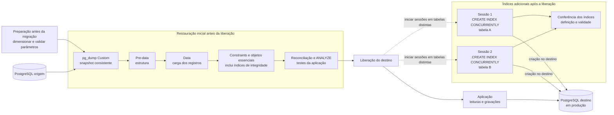

# Migração genérica de PostgreSQL por etapas

Restauração por etapas com liberação do destino e criação posterior de índices usando `CREATE INDEX CONCURRENTLY`.

**Escopo:** procedimento genérico de migração lógica entre bancos PostgreSQL, aplicável a diferentes aplicações e infraestruturas, incluindo instalações próprias e serviços gerenciados que ofereçam os recursos e privilégios necessários.

**Indicação de uso:** bancos PostgreSQL de grande porte, especialmente com tabelas grandes ou muitos índices de construção demorada, quando essa etapa representa uma parcela relevante da janela de manutenção. A adequação depende do volume, do tempo de criação dos índices, dos recursos disponíveis e das exigências da aplicação; não há tamanho mínimo universal.

**Referência técnica:** PostgreSQL 16. Verifique compatibilidade de versões, extensões, permissões e limites do serviço no seu ambiente. `banco_exemplo`, hosts, usuários, tabelas e índices são nomes ilustrativos e devem ser substituídos.

## Objetivo e arquitetura

Restaurar a estrutura e os dados, aplicar as constraints e concluir as validações necessárias para liberar o banco de destino. Após a entrada da aplicação, criar os índices adicionais com CREATE INDEX CONCURRENTLY, distribuindo os trabalhos entre sessões conforme a capacidade disponível.



**Sequência:** preparar e validar parâmetros → restaurar estrutura e dados → concluir integridade e objetos essenciais → validar → liberar o destino → criar índices adicionais com `CONCURRENTLY` → conferir os objetos restantes.

As sessões de índices atuam no mesmo destino usado pela aplicação. Os trabalhos podem ocorrer em paralelo em tabelas diferentes, respeitando a capacidade do servidor. As gravações na origem precisam ser interrompidas para o backup final ou tratadas por um processo de sincronização coordenado, conforme os pré-requisitos.

### Por que usar este método

O principal benefício é **reduzir a janela de indisponibilidade**: liberar o destino depois da carga, da integridade e das validações, enquanto os índices adicionais são construídos com a aplicação em uso.

- **Retorno antecipado da aplicação:** os índices que podem ser adiados deixam de fazer parte da espera para abrir o destino.

- **Integridade antes da liberação:** PKs, UNIQUEs, FKs, constraints de exclusão e os índices necessários à integridade ficam prontos antes de receber novas gravações. [2](https://www.postgresql.org/docs/16/ddl-constraints.html)

- **Continuidade das gravações:** `CREATE INDEX CONCURRENTLY` permite criar os índices restantes sem manter o bloqueio de escrita usado pela criação convencional. A aplicação pode continuar inserindo, atualizando e excluindo registros durante a construção. [5](https://www.postgresql.org/docs/16/sql-createindex.html)

- **Controle dos recursos:** distribuir índices de tabelas diferentes entre sessões permite ajustar a quantidade de trabalhos simultâneos. Memória e workers internos podem ser dimensionados conforme a folga do servidor. [6](https://www.postgresql.org/docs/16/runtime-config-resource.html)

- **Diagnóstico e retomada por objeto:** separar estrutura, dados, constraints e índices facilita localizar falhas, medir cada fase e preparar a retomada apenas dos objetos pendentes, após conferir o que já foi aplicado.

Em relação a uma carga em tabelas já indexadas, carregar os registros antes dos índices adiáveis evita sua manutenção a cada inserção. Um `pg_restore` completo também carrega os dados antes do post-data; o diferencial deste modelo é priorizar os objetos essenciais e transferir os índices elegíveis para depois da liberação. [1](https://www.postgresql.org/docs/16/populate.html)

**O ganho está principalmente na disponibilidade.** A criação concorrente pode levar mais tempo e disputa CPU, memória e armazenamento com a aplicação. O ritmo de criação deve acompanhar a capacidade real do destino. Índices essenciais ao desempenho precisam existir antes da abertura; somente os demais devem ser adiados. [5](https://www.postgresql.org/docs/16/sql-createindex.html)

### O que significa constraints antes dos índices

PKs e constraints UNIQUE normalmente criam seus próprios índices; constraints de exclusão também dependem de índices. Esses índices pertencem à fase de integridade. Índices únicos independentes e índices exigidos por dependências ou pela aplicação também devem estar prontos antes da liberação. A etapa posterior contém apenas os índices que podem ser adiados. [2](https://www.postgresql.org/docs/16/ddl-constraints.html)

Não há percentual de ganho assumido neste procedimento. Registrar os tempos de cada fase e o momento efetivo de liberação para comparar com uma restauração completa na mesma infraestrutura.

## 0 Preparar e configurar o destino antes da migração

Concluir o dimensionamento, o ensaio e os ajustes de servidor **antes de iniciar a migração**, incluindo recarga ou reinício quando necessário. Reservar capacidade para a aplicação que dividirá o destino com a criação dos índices após a liberação.

| Parâmetro ou controle | Preparar antes da migração | Aplicar ou conferir na execução |
| --- | --- | --- |
| `max_worker_processes` | Dimensionar o conjunto de processos; alterações exigem reinício do servidor. | Confirmar o valor efetivo antes de iniciar. |
| `max_parallel_workers` | Dimensionar o conjunto de workers paralelos dentro da capacidade disponível. | Conferir a capacidade compartilhada com outras cargas. |
| `maintenance_work_mem` | Definir e testar o orçamento de memória por operação. | Aplicar o valor planejado em cada sessão de restore ou de índices que precisar dele. |
| `max_parallel_maintenance_workers` | Definir e testar o limite de workers por construção. | Aplicar em cada sessão de criação de índices. |
| Jobs de restore e sessões simultâneas de índices | Ensaiar a concorrência da carga e da criação junto com a aplicação. | Usar os limites planejados e reduzir a concorrência se houver degradação da aplicação. |

Consultar os valores atuais no destino:

```sql
SELECT name, setting, unit, context, pending_restart
FROM pg_settings
WHERE name IN (
  'maintenance_work_mem',
  'max_parallel_maintenance_workers',
  'max_parallel_workers',
  'max_worker_processes'
)
ORDER BY name;
```

Aplicar mudanças globais pela configuração do servidor ou pelo mecanismo do serviço gerenciado. Registrar os valores originais e conferir `pending_restart` após as alterações. Não deixar ajustes que exigem reinício para o meio da migração. [Configuração de recursos](https://www.postgresql.org/docs/16/runtime-config-resource.html)

**Os parâmetros de sessão continuam precisando ser aplicados na abertura de cada conexão.** Um `SET` executado em uma conexão de preparação não configura conexões futuras do `pg_restore` ou `psql`. Preparar os scripts antes da migração e executar os ajustes no início de cada sessão correspondente, antes do seu trabalho. Opções de conexão, como `PGOPTIONS`, também podem ser usadas quando suportadas. [Variáveis de conexão](https://www.postgresql.org/docs/16/libpq-envars.html)

Os valores da etapa 5 são um perfil ilustrativo a validar nesta preparação, não uma recomendação para descobrir ou alterar a configuração somente após a liberação.

## 1 Preparar a migração e o backup

### Condições de execução

- Usar um destino novo ou controladamente vazio. Confirmar versão, extensões, roles, ownership, tablespaces, espaço para dados, índices, temporários e WAL, além das permissões de restauração.

- Interromper as gravações da aplicação na origem antes do backup final e mantê-las interrompidas até a virada. Se houver CDC, concluir a sincronização e validar o atraso zero no corte.

- Definir as consultas e transações críticas que precisam funcionar antes da liberação, incluindo índices de suporte a FKs com alto volume de UPDATE ou DELETE.

O pg_dump produz um retrato consistente, mas não inclui automaticamente alterações posteriores a esse retrato. Este procedimento, por si só, não fornece migração sem perda com gravações contínuas na origem. Roles e outros objetos globais exigem tratamento separado. [3](https://www.postgresql.org/docs/16/app-pgdump.html)

### Backup único em formato Custom

Os blocos de terminal abaixo usam Bash e os clientes PostgreSQL no `PATH`. No Windows, use um terminal compatível com Bash ou adapte a sintaxe ao PowerShell. Substitua os nomes em maiúsculas, caminhos, tabelas e índices. Configure autenticação por `pgpass` ou pelo mecanismo aprovado; não coloque senhas nos comandos.

> No Windows PowerShell 5.1, o redirecionamento `>` pode gerar listas em UTF-16. Ao criar arquivos `.list`, use explicitamente uma codificação compatível com o `pg_restore`, como UTF-8, e confira a leitura antes de executar a restauração.

```bash
pg_dump -h HOST_ORIGEM -p 5432 -U USUARIO_BACKUP -d banco_exemplo -Fc -v -f banco_exemplo.backup 2> 00_backup.log
```

Usar o mesmo arquivo para todas as fases. Não gerar dumps independentes por seção, pois eles podem representar momentos diferentes. Confirmar o término sem erro, o tamanho do arquivo e a conclusão da cópia para o servidor de execução.

### Inventário do arquivo

```bash
pg_restore --list banco_exemplo.backup > toc_completo.list
```

O formato Custom permite seleção de objetos e restauração paralela. O formato Directory também permite ambas e, adicionalmente, dump paralelo. Os exemplos usam Custom. [3](https://www.postgresql.org/docs/16/app-pgdump.html)

Registrar antes do corte: versões de origem e destino; identificação do backup; quantidade de tabelas e objetos; constraints esperadas; índices obrigatórios e adiáveis; responsáveis pela validação e critérios de retorno.

## 2 Restaurar estrutura e registros

### Pre data

```bash
pg_restore -h HOST_DESTINO -p 5432 -U USUARIO_RESTORE -d banco_exemplo --section=pre-data --exit-on-error --verbose banco_exemplo.backup 2> 01_pre_data.log
```

Conferir schemas, tabelas, tipos e demais objetos desta seção. Algumas regras, como NOT NULL e determinadas CHECKs, podem estar no pre-data. Portanto, separar o restore não significa que todas as constraints serão criadas apenas depois dos registros. [4](https://www.postgresql.org/docs/16/app-pgrestore.html)

### Data

```bash
pg_restore -h HOST_DESTINO -p 5432 -U USUARIO_RESTORE -d banco_exemplo --section=data --jobs=4 --exit-on-error --verbose banco_exemplo.backup 2> 02_data.log
```

O valor 4 é um exemplo de concorrência para carga, a ser dimensionado em ensaio. O parâmetro --jobs abre múltiplas conexões; não representa a quantidade de workers de um único CREATE INDEX. [4](https://www.postgresql.org/docs/16/app-pgrestore.html)

### Critérios para avançar

- Código de saída zero e ausência de falhas pendentes nos logs das duas fases. No PowerShell, conferir $LASTEXITCODE imediatamente após cada comando; no shell POSIX, conferir $?.

- Comparar contagens exatas ou controles de reconciliação do snapshot final, priorizando tabelas críticas. Verificar valores de sequências e colunas identity, large objects e dados de extensões quando utilizados.

- Confirmar que a aplicação permanece sem gravar no destino até a conclusão da integridade e da validação operacional.

### Tratamento de falhas

Não repetir cegamente uma fase após uma falha. --exit-on-error interrompe a execução, mas não desfaz os objetos ou dados já confirmados. Identificar o último objeto, corrigir a causa e preparar a retomada apenas do que falta, ou reiniciar a restauração em um destino vazio controlado.

Guardar os logs e os tempos de início e fim. Uma sessão ativa ou uma lista de pendências menor não comprova sucesso: a conclusão deve ser verificada no catálogo e no log.

## 3 Separar e concluir a integridade

### Criar uma seleção revisada do post data

```bash
pg_restore --section=post-data --list banco_exemplo.backup > post_data_completo.list
```

Copiar a lista para integridade_e_essenciais.list. Manter as entradas necessárias antes da liberação e comentar as adiáveis com ponto e vírgula no início da linha. Preservar identificadores e dependências. O pg_restore aceita a lista com --use-list. [4](https://www.postgresql.org/docs/16/app-pgrestore.html)

- Manter PKs, UNIQUEs, constraints de exclusão, FKs e validações necessárias; incluir previamente índices independentes exigidos por essas dependências.

- Manter índices críticos de desempenho e de suporte à operação, além de triggers, regras e outros objetos necessários à aplicação. Conferir também permissões, owners e políticas de segurança no inventário completo.

- Separar os índices adiáveis e seus vínculos: comentários, ownership, permissões ou anexações de índices particionados. Acompanhar cada objeto até a conclusão.

Não selecionar apenas linhas contendo CONSTRAINT. Essa filtragem pode excluir dependências, índices únicos independentes e objetos essenciais. Para FKs, as chaves referenciadas precisam existir primeiro. A lista deve ser ensaiada com o backup e a versão usados na migração.

### Aplicar a seleção

```bash
pg_restore -h HOST_DESTINO -p 5432 -U USUARIO_RESTORE -d banco_exemplo --section=post-data --use-list=integridade_e_essenciais.list --exit-on-error --verbose banco_exemplo.backup 2> 03_integridade.log
```

A execução do exemplo é sequencial para facilitar a conferência das dependências. Ajustes de concorrência nesta fase exigem ensaio. Não executar depois o post-data completo, pois isso tentará recriar objetos já aplicados e criará índices sem CONCURRENTLY.

### Conferir a integridade

```sql
SELECT conrelid::regclass AS tabela, conname, contype
FROM pg_constraint
WHERE connamespace NOT IN
  ('pg_catalog'::regnamespace, 'information_schema'::regnamespace)
  AND NOT convalidated
ORDER BY 1, 2;
```

Investigar o resultado e comparar o conjunto completo com a origem e a lista esperada. A consulta identifica constraints não validadas, mas não detecta constraints ausentes. Não adotar NOT VALID apenas para antecipar a liberação.

## 4 Validar e liberar o destino

### Concluir as condições de entrada em produção

- Confirmar carga reconciliada, constraints obrigatórias presentes e validadas, índices essenciais válidos e ausência de erros pendentes.

- Verificar triggers, funções, regras, políticas RLS, roles, owners, grants, sequências e configuração da conexão da aplicação.

- Atualizar estatísticas e executar testes de consulta, inserção, atualização e exclusão nos fluxos críticos, com a identidade real da aplicação.

- Confirmar a sincronização final, quando houver, e impedir gravações simultâneas indevidas na origem. Redirecionar a aplicação ao destino e acompanhar erros e latência.

```sql
ANALYZE;
```

Executar ANALYZE com a conta e o escopo que cubram as tabelas restauradas. A atualização das estatísticas após a carga melhora as decisões do otimizador. Repetir nas tabelas relevantes após criar índices de expressão ou após alterações significativas nos dados. [1](https://www.postgresql.org/docs/16/populate.html)

### Condição para postergar um índice

Postergar somente os índices cuja ausência foi avaliada nos fluxos reais. Um índice secundário pode ser essencial ao tempo de resposta ou à verificação de relacionamentos. Se a aplicação depende dele para operar dentro dos limites definidos, criá-lo antes da liberação.

### Registrar a liberação

Registrar o horário da entrada da aplicação, os testes executados, o resultado da reconciliação e a lista dos índices adiados. Esse horário encerra a indisponibilidade planejada; a migração só termina após conferir os objetos restantes.

### Criar a fila dos índices restantes

```bash
pg_restore --section=post-data --use-list=indices_adiados.list --file=04_indices_extraidos.sql banco_exemplo.backup
```

Preparar indices_adiados.list a partir do inventário revisado. O arquivo SQL extraído é material de preparação e NÃO deve ser executado diretamente após a liberação. O pg_restore não tem uma opção que converta sua criação de índices em CONCURRENTLY.

Revisar os CREATE INDEX elegíveis e gerar arquivos por sessão com CREATE INDEX CONCURRENTLY. Preservar método, colunas, expressões, predicados, INCLUDE, tablespace e opções. Não alterar o SQL com substituição textual indiscriminada.

## 5 Criar índices com a aplicação em uso

### Aplicar o perfil de sessão preparado e criar os índices

**Parâmetros centrais:** `maintenance_work_mem` para memória de construção e `max_parallel_maintenance_workers` para paralelismo interno.

Perfil ilustrativo para dimensionar e testar antes da migração, condicionado à folga de CPU, RAM e I/O. Nesta etapa, aplicar o perfil definido na etapa 0. Inserir os SETs em cada arquivo executado pelo psql; configurações feitas em outra conexão não são herdadas.

```sql
SET application_name = 'migracao_indices_01';
SET maintenance_work_mem = '1GB';
SET max_parallel_maintenance_workers = 2;
SET lock_timeout = '5s';
 
CREATE INDEX CONCURRENTLY idx_tabela_coluna
  ON public.tabela USING btree (coluna);
```

**Não confundir:** `CONCURRENTLY` preserva a disponibilidade de escrita; o paralelismo de processamento depende dos workers e da quantidade de sessões.

Substituir o índice ilustrativo pela definição real. Executar fora de BEGIN/COMMIT, em autocommit. CONCURRENTLY permite gravações durante a construção, mas acrescenta trabalho, esperas e consumo de recursos. É uma escolha de disponibilidade. [5](https://www.postgresql.org/docs/16/sql-createindex.html)

### Executar mais de um índice ao mesmo tempo

```bash
psql -X -h HOST_DESTINO -p 5432 -U USUARIO_INDICES -d banco_exemplo -v ON_ERROR_STOP=1 -f indices_sessao_01.sql > indices_01.log 2>&1
 
psql -X -h HOST_DESTINO -p 5432 -U USUARIO_INDICES -d banco_exemplo -v ON_ERROR_STOP=1 -f indices_sessao_02.sql > indices_02.log 2>&1
```

Executar os dois comandos em terminais distintos. Cada arquivo processa seus índices em sequência. **Distribuir sessões por tabelas diferentes:** no PostgreSQL 16, há somente uma construção concorrente por tabela de cada vez.

No PostgreSQL 16, `CREATE INDEX CONCURRENTLY` não é suportado diretamente no pai particionado. Planejar a criação concorrente nas partições e a montagem do índice pai e suas anexações separadamente. [5](https://www.postgresql.org/docs/16/sql-createindex.html)

### Parâmetros de desempenho

maintenance_work_mem fornece o orçamento de memória de cada construção; max_parallel_maintenance_workers limita os workers internos. No PostgreSQL 16, a construção paralela de índices se aplica a B-tree e depende também de max_parallel_workers e max_worker_processes. [6](https://www.postgresql.org/docs/16/runtime-config-resource.html)

```sql
SHOW max_parallel_workers;
SHOW max_worker_processes;
SHOW max_parallel_maintenance_workers;
SHOW maintenance_work_mem;
```

O ganho de `max_parallel_maintenance_workers` no modo concorrente se concentra na primeira varredura; aumentar workers não acelera todas as fases. [5](https://www.postgresql.org/docs/16/sql-createindex.html)

Com duas construções de 1 GB, prever até cerca de 2 GB de orçamento de manutenção, além da memória da aplicação e demais processos. Com dois workers por construção, podem existir dois coordenadores e até quatro workers, se disponíveis. A memória de manutenção não é multiplicada novamente por esses workers. [6](https://www.postgresql.org/docs/16/runtime-config-resource.html)

Começar com uma sessão e ampliar após observar o impacto. Aumentar memória ou workers não supera armazenamento saturado. No serviço gerenciado, conferir limites e permissões do provedor antes de alterar configurações globais.

## 6 Acompanhar e encerrar a migração

### Progresso dos índices no destino

```sql
SELECT pid, relid::regclass AS tabela,
       index_relid::regclass AS indice, phase,
       blocks_done, blocks_total,
       round(100.0 * blocks_done /
         NULLIF(blocks_total, 0), 1) AS pct_blocos_fase
FROM pg_stat_progress_create_index
WHERE datname = current_database();
```

O percentual representa os blocos da fase corrente quando informados; não é o percentual total nem uma previsão linear de término. Algumas fases aguardam transações antigas. Usar a visão junto com logs, sessões, latência da aplicação, CPU, I/O, memória e espaço livre. [7](https://www.postgresql.org/docs/16/progress-reporting.html)

### Localizar índices inválidos

```sql
SELECT n.nspname AS schema_nome, c.relname AS indice,
       i.indrelid::regclass AS tabela,
       i.indisvalid, i.indisready
FROM pg_index i
JOIN pg_class c ON c.oid = i.indexrelid
JOIN pg_namespace n ON n.oid = c.relnamespace
WHERE n.nspname NOT IN ('pg_catalog', 'information_schema')
  AND (NOT i.indisvalid OR NOT i.indisready)
ORDER BY 1, 2;
```

Falhas e cancelamentos de builds concorrentes podem deixar índices inválidos. Investigar o log e as dependências antes de remover e recriar o objeto; não usar IF NOT EXISTS como comprovação de sucesso. Não lançar novas tarefas se a aplicação ultrapassar os limites operacionais definidos. [5](https://www.postgresql.org/docs/16/sql-createindex.html)

### Conferência final e retorno

Comparar todos os índices e demais objetos com o inventário esperado. Verificar definição, validade, vínculo com constraints e partições, além dos logs de cada sessão. Registrar o término e fechar as pendências. A ausência de índices inválidos não comprova que todos os índices esperados existem.

Depois de o destino receber gravações, o retorno à origem precisa reconciliar essas alterações. Não redirecionar a aplicação de volta para um banco desatualizado. Preservar o backup final e as evidências de corte conforme a política operacional. Encerrar as sessões exclusivas da migração e revisar ajustes globais temporários com base nos valores originais; agendar manutenção se a reversão exigir reinício.

### Referências técnicas

- [1 — Carga em massa e ANALYZE](https://www.postgresql.org/docs/16/populate.html)
- [2 — Constraints](https://www.postgresql.org/docs/16/ddl-constraints.html)
- [3 — pg_dump](https://www.postgresql.org/docs/16/app-pgdump.html)
- [4 — pg_restore](https://www.postgresql.org/docs/16/app-pgrestore.html)
- [5 — CREATE INDEX](https://www.postgresql.org/docs/16/sql-createindex.html)
- [6 — Recursos e memória](https://www.postgresql.org/docs/16/runtime-config-resource.html)
- [7 — Progresso](https://www.postgresql.org/docs/16/progress-reporting.html)
