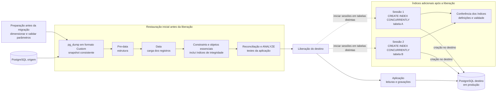

# Migração lógica de PostgreSQL em etapas com criação postergada de índices

Restaurar a estrutura, os dados e as constraints de integridade primeiro, liberar o destino para a aplicação e criar os índices adicionais elegíveis depois, usando `CREATE INDEX CONCURRENTLY`.

[Read in English](README.md)

## Visão geral

Este procedimento genérico de migração PostgreSQL separa o trabalho necessário para a virada da aplicação da criação de índices que pode ser adiada. Aplica-se a diferentes aplicações e infraestruturas, incluindo instalações próprias e serviços gerenciados que ofereçam os recursos e privilégios necessários.

**Indicação de uso:** bancos PostgreSQL de grande porte, especialmente com tabelas grandes ou muitos índices de construção demorada, quando essa etapa representa uma parcela relevante da janela de manutenção. A adequação depende do volume, do tempo de criação dos índices, dos recursos disponíveis e das exigências da aplicação; não há tamanho mínimo universal.

**Referência técnica:** PostgreSQL 16. Verificar compatibilidade de versões, extensões, permissões e limites do serviço. Os nomes de bancos, hosts, usuários, tabelas e índices abaixo são exemplos.

**Terminologia:** “migração lógica em etapas com criação postergada de índices” é um nome descritivo, não uma modalidade oficialmente nomeada pelo PostgreSQL. A implementação utiliza a restauração seletiva das seções `pre-data`, `data` e `post-data`. [Documentação do pg_restore](https://www.postgresql.org/docs/16/app-pgrestore.html)

## Arquitetura e sequência



**Sequência:** preparar e validar parâmetros → restaurar estrutura e dados → concluir integridade e objetos essenciais → validar → liberar o destino → criar índices adicionais com `CONCURRENTLY` → conferir os objetos restantes.

A aplicação e as sessões de criação de índices usam o mesmo banco de destino. Construções em tabelas diferentes podem ocorrer simultaneamente, respeitando a capacidade disponível. As gravações na origem precisam ser interrompidas para o backup final ou tratadas por um processo de sincronização coordenado separadamente.

## Benefícios e limitações

O principal benefício é **reduzir a janela de indisponibilidade da aplicação**: os índices adicionais elegíveis deixam de precisar estar concluídos antes de o destino começar a receber tráfego.

- **Retorno antecipado da aplicação:** adiar os índices que não são necessários à integridade nem ao desempenho aceitável da aplicação.
- **Integridade antes da liberação:** concluir PKs, UNIQUEs, FKs, constraints de exclusão e os índices de suporte necessários antes de receber novas gravações. [Constraints](https://www.postgresql.org/docs/16/ddl-constraints.html)
- **Continuidade das gravações durante a criação dos índices:** `CREATE INDEX CONCURRENTLY` evita o bloqueio de escrita mantido por uma construção convencional. [CREATE INDEX](https://www.postgresql.org/docs/16/sql-createindex.html)
- **Controle dos recursos:** ajustar construções simultâneas, memória de manutenção e workers internos à capacidade disponível. [Configuração de recursos](https://www.postgresql.org/docs/16/runtime-config-resource.html)
- **Diagnóstico e retomada mais claros:** logs separados e inventários de objetos ajudam a localizar falhas e preparar uma recuperação direcionada, após conferir o que já foi aplicado.

Carregar os dados antes de criar os índices adiáveis evita sua manutenção a cada registro inserido. Um `pg_restore` completo já carrega os dados antes dos objetos de post-data; este modelo também prioriza os objetos essenciais e transfere os índices elegíveis para depois da liberação. [Carga em massa](https://www.postgresql.org/docs/16/populate.html)

**O ganho principal está na disponibilidade, sem garantia de menor tempo total de migração.** A construção concorrente exige trabalho adicional e disputa recursos com a aplicação. Índices essenciais ao desempenho precisam existir antes da liberação. Medir cada fase e a indisponibilidade real, sem assumir um percentual fixo de ganho.

### O que significa constraints antes dos índices

PKs e constraints UNIQUE normalmente criam seus próprios índices. Constraints de exclusão também dependem de índices. Esses objetos pertencem à fase de integridade. Índices únicos independentes e outros índices exigidos por dependências ou pela aplicação também devem estar prontos antes da liberação. Somente os índices adicionais elegíveis são adiados. [Constraints](https://www.postgresql.org/docs/16/ddl-constraints.html)

## 0 Preparar e configurar o destino antes da migração

Concluir o dimensionamento, o ensaio e os ajustes de servidor **antes de iniciar a migração**, incluindo recarga ou reinício quando necessário. Reservar recursos para a aplicação que dividirá o destino com as construções de índices após a liberação.

| Parâmetro ou controle | Preparar antes da migração | Aplicar ou conferir na execução |
| --- | --- | --- |
| `max_worker_processes` | Dimensionar o conjunto de processos; alterações exigem reinício do servidor. | Confirmar o valor efetivo antes de iniciar. |
| `max_parallel_workers` | Dimensionar o conjunto de workers paralelos dentro da capacidade disponível. | Conferir a capacidade compartilhada com outras cargas. |
| `maintenance_work_mem` | Definir e testar o orçamento de memória por operação. | Aplicar o valor planejado em cada sessão de restore ou de índices que precisar dele. |
| `max_parallel_maintenance_workers` | Definir e testar o limite de workers por construção. | Aplicar em cada sessão de criação de índices. |
| Jobs de restore e sessões simultâneas de índices | Ensaiar a concorrência da carga e das construções junto com a aplicação. | Usar os limites planejados e reduzir a concorrência se houver degradação. |

Consultar os valores atuais no destino:

```sql
SELECT name, setting, unit, context, pending_restart
FROM pg_settings
WHERE name IN (
  'maintenance_work_mem',
  'max_parallel_maintenance_workers',
  'max_parallel_workers',
  'max_worker_processes'
)
ORDER BY name;
```

### Aplicar os aumentos planejados antes de iniciar

O perfil abaixo é um **exemplo para um destino com CPU e RAM suficientes**, não uma recomendação universal para bancos grandes. Comparar com os valores existentes: não substituir um valor maior, configurado deliberadamente, por um exemplo menor. Considerar extensões e outros processos de background, além do tráfego da aplicação.

| Parâmetro | Valor ilustrativo | Escopo utilizado abaixo |
| --- | --- | --- |
| `max_worker_processes` | `16` | Servidor; exige reinício |
| `max_parallel_workers` | `8` | Servidor; recarga |
| `maintenance_work_mem` | `1GB` | Login dedicado à migração no banco de destino |
| `max_parallel_maintenance_workers` | `2` | Login dedicado à migração no banco de destino |

#### Configurar os limites de workers do servidor

Em um destino administrado pela própria equipe, conectar com privilégios administrativos suficientes e executar cada comando fora de um bloco de transação:

```sql
ALTER SYSTEM SET max_worker_processes = 16;
ALTER SYSTEM SET max_parallel_workers = 8;

SELECT pg_reload_conf();
```

`ALTER SYSTEM` grava configurações globais em `postgresql.auto.conf`. A recarga aplica os parâmetros que a permitem; alterar `max_worker_processes` exige reinício do servidor. [ALTER SYSTEM](https://www.postgresql.org/docs/16/sql-altersystem.html)

Se `max_worker_processes` foi alterado, reiniciar o destino **antes da migração**, usando o mecanismo normal de administração do serviço. Em uma instalação própria administrada com `pg_ctl`, o comando equivalente é:

```bash
# Executar com o usuário do PostgreSQL no sistema operacional; substituir o diretório de dados.
pg_ctl -D "/path/to/PGDATA" restart -m fast
```

Usar esse comando somente em uma instância administrada com `pg_ctl`. Instalações gerenciadas por systemd, Serviços do Windows, contêineres ou um operador devem utilizar o mecanismo correspondente. O reinício desconecta as sessões existentes.

Em serviços PostgreSQL gerenciados, aplicar os valores planejados pela configuração de parâmetros do provedor e usar seu mecanismo de reinício quando necessário. Não presumir disponibilidade de `ALTER SYSTEM` ou de acesso ao sistema operacional.

#### Configurar os logins dedicados ao restore e aos índices

Para definir os parâmetros de manutenção **antes da migração**, sem elevar a memória padrão de todas as sessões da aplicação, configurar valores padrão para os logins dedicados no banco de destino. Substituir `RESTORE_USER`, `INDEX_USER` e `example_db` por objetos existentes. Registrar as configurações anteriores de role e banco antes de alterá-las.

```sql
SELECT COALESCE(r.rolname, 'ALL') AS role_name,
       COALESCE(d.datname, 'ALL') AS database_name,
       s.setconfig
FROM pg_db_role_setting s
LEFT JOIN pg_roles r ON r.oid = s.setrole
LEFT JOIN pg_database d ON d.oid = s.setdatabase
ORDER BY 1, 2;
```

Executar com os privilégios necessários para alterar esses valores padrão:

```sql
ALTER ROLE RESTORE_USER IN DATABASE example_db
  SET maintenance_work_mem = '1GB';
ALTER ROLE RESTORE_USER IN DATABASE example_db
  SET max_parallel_maintenance_workers = 2;

ALTER ROLE INDEX_USER IN DATABASE example_db
  SET maintenance_work_mem = '1GB';
ALTER ROLE INDEX_USER IN DATABASE example_db
  SET max_parallel_maintenance_workers = 2;
```

Se um único login dedicado executar as duas tarefas, configurá-lo uma vez. Esses valores se aplicam a **novas conexões** autenticadas diretamente com a role no banco de destino; `SET ROLE` não os carrega. Reconectar antes de validar ou iniciar o restore. [ALTER ROLE](https://www.postgresql.org/docs/16/sql-alterrole.html)

Manter esses logins separados do login da aplicação. O orçamento de memória é por operação de manutenção: construções simultâneas podem usar suas próprias alocações. Os exemplos de `SET` na etapa 5 podem reaplicar os mesmos valores preparados ou substituí-los explicitamente.

#### Validar a configuração efetiva

Após o reinício necessário, abrir uma nova conexão com cada login dedicado e executar:

```sql
SHOW max_worker_processes;
SHOW max_parallel_workers;
SHOW maintenance_work_mem;
SHOW max_parallel_maintenance_workers;

SELECT name, setting, unit, source, pending_restart
FROM pg_settings
WHERE name IN (
  'max_worker_processes',
  'max_parallel_workers',
  'maintenance_work_mem',
  'max_parallel_maintenance_workers'
)
ORDER BY name;
```

Confirmar os valores efetivos planejados e a ausência de reinícios pendentes para esses parâmetros antes de iniciar a migração. Ensaiar a quantidade de jobs do restore e as construções simultâneas com essa configuração. Ao terminar, restaurar os ajustes temporários aos valores registrados; não usar `RESET` indiscriminadamente se já existiam valores personalizados.

Usar a configuração do servidor ou o mecanismo do serviço gerenciado para alterações globais. Registrar os valores originais e conferir `pending_restart`. Não deixar ajustes que exigem reinício para o meio da migração. [Configuração de recursos](https://www.postgresql.org/docs/16/runtime-config-resource.html)

**Os parâmetros devem estar efetivos em cada conexão de trabalho.** Os padrões definidos por `ALTER ROLE ... IN DATABASE` inicializam novas conexões automaticamente. Como alternativa, aplicar os parâmetros preparados em cada sessão. Um `SET` em uma conexão de preparação não configura conexões futuras do `pg_restore` ou `psql`. Preparar os scripts antes da migração e aplicar os ajustes no início de cada sessão correspondente. Opções de conexão, como `PGOPTIONS`, também podem ser usadas quando suportadas. [Variáveis de conexão](https://www.postgresql.org/docs/16/libpq-envars.html)

Os valores da etapa 5 são um perfil ilustrativo a validar nesta preparação, não uma recomendação para definir os parâmetros somente após a liberação.

## 1 Preparar a migração e o backup

### Pré-requisitos

- Preparar um destino novo ou deliberadamente vazio. Conferir versões, extensões, roles, ownership, tablespaces, privilégios e espaço para dados, índices, temporários e WAL.
- Interromper as gravações na origem antes do dump final e mantê-las interrompidas até a virada. Se houver CDC, coordenar o snapshot e concluir a sincronização final antes de redirecionar a aplicação.
- Identificar transações e índices essenciais à liberação, incluindo o suporte às verificações de FKs com volume significativo de atualizações ou exclusões.
- Registrar o inventário esperado de objetos, os responsáveis pela validação e os critérios de retorno.

`pg_dump` produz um snapshot consistente, mas não inclui automaticamente alterações posteriores. Este procedimento, isoladamente, não oferece migração sem perda enquanto as gravações na origem continuam. Objetos globais, como roles, exigem tratamento separado. [pg_dump](https://www.postgresql.org/docs/16/app-pgdump.html)

### Criar um único backup em formato Custom

Os exemplos usam Bash e clientes PostgreSQL no `PATH`. Substituir os nomes em maiúsculas, bancos, caminhos, tabelas e índices. Configurar autenticação por `pgpass` ou pelo mecanismo aprovado; não incluir senhas nos comandos.

No Windows, usar um ambiente Bash compatível ou adaptar os comandos ao PowerShell. O Windows PowerShell 5.1 pode gravar redirecionamentos em UTF-16; utilizar explicitamente uma codificação compatível, como UTF-8, nos arquivos `.list` e conferir a leitura pelo `pg_restore`.

```bash
pg_dump -h SOURCE_HOST -p 5432 -U BACKUP_USER -d example_db -Fc -v -f example_db.backup 2> 00_backup.log
```

Usar o mesmo arquivo em todas as fases. Dumps separados de cada seção podem representar snapshots diferentes. Confirmar conclusão sem erro, tamanho do arquivo e transferência ao servidor de execução.

```bash
pg_restore --list example_db.backup > full_toc.list
```

Os formatos Custom e Directory permitem restauração seletiva e paralela. Directory também permite dump paralelo; este guia utiliza Custom. [pg_dump](https://www.postgresql.org/docs/16/app-pgdump.html)

## 2 Restaurar a estrutura e os dados

### Pre-data

```bash
pg_restore -h TARGET_HOST -p 5432 -U RESTORE_USER -d example_db --section=pre-data --exit-on-error --verbose example_db.backup 2> 01_pre_data.log
```

Conferir schemas, tabelas, tipos e demais objetos da seção. Algumas constraints, incluindo NOT NULL e determinadas CHECKs, podem estar no pre-data; nem todas são criadas após a carga. [pg_restore](https://www.postgresql.org/docs/16/app-pgrestore.html)

### Data

```bash
pg_restore -h TARGET_HOST -p 5432 -U RESTORE_USER -d example_db --section=data --jobs=4 --exit-on-error --verbose example_db.backup 2> 02_data.log
```

`--jobs=4` é um exemplo para teste. Controla conexões simultâneas de restore, não os workers internos de uma única construção de índice. [pg_restore](https://www.postgresql.org/docs/16/app-pgrestore.html)

Antes de avançar:

- Conferir código de saída zero e resolver erros nos logs. Verificar `$?` imediatamente no Bash ou `$LASTEXITCODE` no PowerShell.
- Comparar contagens críticas ou totais de controle com o snapshot final da origem. Conferir sequências, valores de identity, large objects e dados de extensões quando aplicável.
- Manter as gravações da aplicação desabilitadas no destino até concluir integridade e validação operacional.

`--exit-on-error` interrompe a execução, mas não desfaz objetos ou dados já confirmados. Identificar o que foi aplicado e preparar uma retomada direcionada, ou reiniciar em um destino vazio controlado. Não repetir indiscriminadamente uma carga parcial.

## 3 Separar e concluir os objetos de integridade

### Preparar uma seleção revisada do post-data

```bash
pg_restore --section=post-data --list example_db.backup > full_post_data.list
```

Copiar a lista para `integrity_and_essential.list`. Manter as entradas necessárias antes da liberação e comentar as adiáveis com ponto e vírgula no início da linha. Preservar os identificadores e a ordem de dependências. [pg_restore](https://www.postgresql.org/docs/16/app-pgrestore.html)

- Manter constraints e validações obrigatórias, incluindo índices independentes dos quais dependam.
- Manter índices de desempenho essenciais, triggers, regras e demais requisitos da aplicação. Conferir owners, grants e políticas de segurança por linha no inventário completo.
- Acompanhar índices adiados e metadados relacionados, incluindo comentários e anexações de índices de partições, até a conclusão.

**Não selecionar entradas apenas procurando `CONSTRAINT`.** Isso pode omitir dependências e objetos essenciais. As chaves referenciadas precisam existir antes das FKs. Ensaiar a seleção com o backup e a versão PostgreSQL previstos.

### Aplicar a seleção

```bash
pg_restore -h TARGET_HOST -p 5432 -U RESTORE_USER -d example_db --section=post-data --use-list=integrity_and_essential.list --exit-on-error --verbose example_db.backup 2> 03_integrity.log
```

O exemplo é sequencial para facilitar a conferência das dependências. Ensaiar alterações de concorrência. Não executar depois o post-data completo: isso tentaria recriar objetos concluídos e criaria índices sem `CONCURRENTLY`.

### Conferir a validação das constraints

```sql
SELECT conrelid::regclass AS table_name, conname, contype
FROM pg_constraint
WHERE connamespace NOT IN
  ('pg_catalog'::regnamespace, 'information_schema'::regnamespace)
  AND NOT convalidated
ORDER BY 1, 2;
```

Investigar os resultados e comparar o inventário completo com a origem. A consulta identifica constraints não validadas, mas não detecta as ausentes. Não introduzir `NOT VALID` apenas para antecipar a liberação.

## 4 Validar e liberar o destino

Antes de redirecionar a aplicação:

- Confirmar reconciliação dos dados, constraints obrigatórias validadas, índices essenciais válidos e ausência de erros pendentes.
- Conferir triggers, funções, regras, políticas RLS, roles, owners, grants, sequências e conexões da aplicação.
- Atualizar estatísticas e testar leituras, inserções, atualizações e exclusões críticas usando a identidade real da aplicação no banco.
- Concluir a sincronização final quando aplicável, impedir gravações indevidas nos dois bancos e redirecionar a aplicação ao destino.

```sql
ANALYZE;
```

Executar `ANALYZE` com privilégios e escopo que cubram as tabelas restauradas. Atualizar novamente as estatísticas relevantes após criar índices de expressão ou após mudanças significativas nos dados. [Carga em massa](https://www.postgresql.org/docs/16/populate.html)

Adiar um índice somente após avaliar o comportamento real da aplicação sem ele. Índices secundários podem ser essenciais ao tempo de resposta ou às verificações de relacionamento; criá-los antes da liberação.

Registrar o horário da virada, os testes, a reconciliação e o inventário de índices adiados. A indisponibilidade termina com a liberação bem-sucedida; a migração termina após conferir todos os objetos restantes.

### Preparar os scripts dos índices adiados

Criar `deferred_indexes.list` a partir do inventário revisado e extrair o SQL:

```bash
pg_restore --section=post-data --use-list=deferred_indexes.list --file=04_extracted_indexes.sql example_db.backup
```

**Não executar esse arquivo sem adaptação após a liberação.** O `pg_restore` não possui opção para converter a criação dos índices em construções concorrentes.

Revisar os comandos elegíveis e preparar scripts por sessão com `CREATE INDEX CONCURRENTLY`. Preservar métodos, colunas, expressões, predicados, colunas INCLUDE, tablespaces e opções de armazenamento. Evitar substituições textuais indiscriminadas. Aplicar os metadados relacionados após a criação dos seus objetos.

## 5 Criar índices adicionais com a aplicação em uso

### Aplicar o perfil de sessão preparado e criar os índices

Os principais parâmetros de desempenho são `maintenance_work_mem`, para memória de construção, e `max_parallel_maintenance_workers`, para workers internos.

Os valores abaixo são **exemplos para dimensionar e testar antes da migração**, conforme a capacidade de CPU, RAM e I/O. Nesta etapa, aplicar o perfil definido na etapa 0. Incluir os ajustes em cada script; um `SET` feito em outra conexão não é herdado.

```sql
SET application_name = 'migration_indexes_01';
SET maintenance_work_mem = '1GB';
SET max_parallel_maintenance_workers = 2;
SET lock_timeout = '5s';

CREATE INDEX CONCURRENTLY idx_example_table_column
  ON public.example_table USING btree (example_column);
```

Substituir o exemplo pela definição real do índice. Executar em autocommit, fora de `BEGIN`/`COMMIT`.

`CONCURRENTLY` trata da disponibilidade de escrita; o paralelismo de processamento depende dos workers internos e da quantidade de sessões. Construções concorrentes acrescentam trabalho e esperas, podendo levar mais tempo que construções convencionais. [CREATE INDEX](https://www.postgresql.org/docs/16/sql-createindex.html)

### Executar mais de uma construção

Executar os comandos abaixo em **terminais separados**. Cada arquivo processa seus índices sequencialmente:

```bash
psql -X -h TARGET_HOST -p 5432 -U INDEX_USER -d example_db -v ON_ERROR_STOP=1 -f indexes_session_01.sql > indexes_01.log 2>&1
```

```bash
psql -X -h TARGET_HOST -p 5432 -U INDEX_USER -d example_db -v ON_ERROR_STOP=1 -f indexes_session_02.sql > indexes_02.log 2>&1
```

Distribuir **tabelas diferentes entre as sessões**. O PostgreSQL 16 permite somente uma construção concorrente por tabela de cada vez. A criação concorrente não é suportada diretamente no pai particionado: planejar as construções nas partições e as etapas do índice pai e de anexação separadamente. [CREATE INDEX](https://www.postgresql.org/docs/16/sql-createindex.html)

### Respeitar a capacidade disponível

```sql
SHOW max_parallel_workers;
SHOW max_worker_processes;
SHOW max_parallel_maintenance_workers;
SHOW maintenance_work_mem;
```

No PostgreSQL 16, a construção paralela de índices se aplica a B-tree. Os workers são limitados por `max_parallel_maintenance_workers`, pela capacidade disponível em `max_parallel_workers` e por `max_worker_processes`. Os workers solicitados podem não estar disponíveis. [Configuração de recursos](https://www.postgresql.org/docs/16/runtime-config-resource.html)

Em construções concorrentes, somente a primeira varredura da tabela ocorre em paralelo; aumentar workers não acelera todas as fases. [CREATE INDEX](https://www.postgresql.org/docs/16/sql-createindex.html)

Com duas construções simultâneas configuradas com 1 GB cada, prever aproximadamente 2 GB de memória de manutenção, além da memória da aplicação e dos demais processos. Com dois workers por construção, podem existir dois processos coordenadores e até quatro workers. A memória de manutenção se aplica à construção inteira, não a cada worker separadamente. [Configuração de recursos](https://www.postgresql.org/docs/16/runtime-config-resource.html)

Começar com uma sessão e aumentar a concorrência após observar o impacto na aplicação. Mais memória ou workers não resolvem armazenamento saturado. Em serviços gerenciados, conferir permissões e limites do provedor antes de alterar parâmetros globais.

## 6 Acompanhar e concluir a migração

### Progresso da criação dos índices

```sql
SELECT pid, relid::regclass AS table_name,
       index_relid::regclass AS index_name, phase,
       blocks_done, blocks_total,
       round(100.0 * blocks_done /
         NULLIF(blocks_total, 0), 1) AS current_phase_blocks_pct
FROM pg_stat_progress_create_index
WHERE datname = current_database();
```

O percentual representa os blocos da fase atual quando disponíveis, não a conclusão total nem uma previsão linear confiável de término. Algumas fases aguardam transações antigas. Acompanhar também logs, sessões, latência da aplicação, CPU, I/O, memória e espaço livre. [Acompanhamento de progresso](https://www.postgresql.org/docs/16/progress-reporting.html)

### Localizar índices inválidos

```sql
SELECT n.nspname AS schema_name, c.relname AS index_name,
       i.indrelid::regclass AS table_name,
       i.indisvalid, i.indisready
FROM pg_index i
JOIN pg_class c ON c.oid = i.indexrelid
JOIN pg_namespace n ON n.oid = c.relnamespace
WHERE n.nspname NOT IN ('pg_catalog', 'information_schema')
  AND (NOT i.indisvalid OR NOT i.indisready)
ORDER BY 1, 2;
```

Falhas ou cancelamentos podem deixar índices inválidos. Investigar logs e dependências antes de remover e recriar um objeto. `IF NOT EXISTS` não comprova validade nem equivalência de um índice existente. Não iniciar novas construções se os limites de serviço da aplicação forem ultrapassados. [CREATE INDEX](https://www.postgresql.org/docs/16/sql-createindex.html)

### Conferência final e retorno

Comparar todos os índices esperados e objetos restantes com o inventário. Conferir definições, validade, vínculos com constraints e partições, metadados relacionados e logs das sessões. Uma consulta sem índices inválidos não comprova que todos os índices esperados existem.

Depois que o destino recebe gravações, o retorno à origem exige reconciliar essas alterações. Não redirecionar a aplicação a um banco desatualizado. Preservar o backup e as evidências conforme a política operacional. Encerrar as sessões dedicadas e revisar mudanças globais temporárias com base nos valores originais; agendar manutenção se a reversão exigir reinício.

## Referências

- [Carga em massa e ANALYZE](https://www.postgresql.org/docs/16/populate.html)
- [Constraints](https://www.postgresql.org/docs/16/ddl-constraints.html)
- [pg_dump](https://www.postgresql.org/docs/16/app-pgdump.html)
- [pg_restore](https://www.postgresql.org/docs/16/app-pgrestore.html)
- [CREATE INDEX](https://www.postgresql.org/docs/16/sql-createindex.html)
- [Configuração de recursos](https://www.postgresql.org/docs/16/runtime-config-resource.html)
- [Acompanhamento de progresso](https://www.postgresql.org/docs/16/progress-reporting.html)
